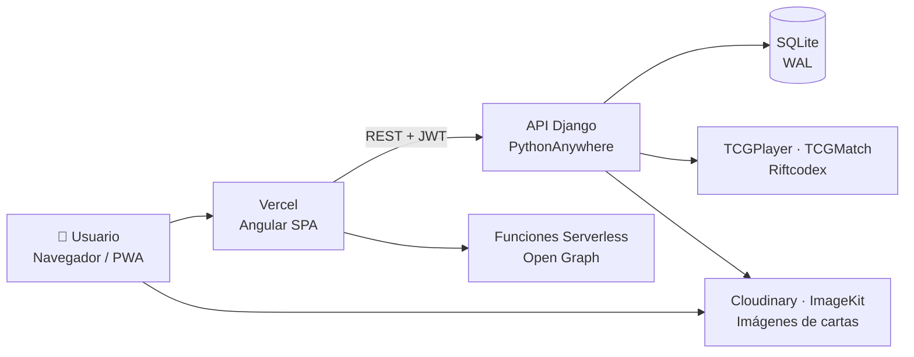

<div align="center">

# ⚔️ ShadowForge

**Plataforma web para construir, validar, compartir y comerciar mazos de juegos de cartas coleccionables.**

Soporte completo para **Mitos y Leyendas (MyL)** y **Riftbound (League of Legends TCG)**.


[Características](#-características-principales) •
[Tecnologías](#-tecnologías) •
[Arquitectura](#-arquitectura) •
[Reglas de juego](#-motor-de-reglas) •
[Instalación](#-instalación-local) •
[Despliegue](#-despliegue)

</div>

---

## 📖 ¿Qué es ShadowForge?

**ShadowForge** es una aplicación web *full-stack* pensada para la comunidad de jugadores de cartas coleccionables en Chile y Latinoamérica. Reúne en un solo lugar todo lo que un jugador necesita:

- 🃏 **Explorar el catálogo** completo de cartas con filtros avanzados.
- 🛠️ **Construir mazos** con validación de reglas en tiempo real (formatos, banlist, razas, copias).
- 📤 **Compartir** mazos como imagen, PDF o enlace con vista previa social.
- 📚 **Gestionar su colección** (carpeta), su lista de deseos y hasta **una tienda propia** para vender cartas.
- 👥 **Formar equipos**, comentar, dar "me gusta" y comparar mazos.
- 🎮 **Jugar una Wordle diaria** temática de cartas.

La plataforma maneja **dos juegos con reglas completamente distintas** en dominios de datos separados, de modo que cada uno puede evolucionar sin afectar al otro.

---

## ✨ Características principales

### 🛠️ Constructor de mazos

| Función | Mitos y Leyendas | Riftbound |
|---|:---:|:---:|
| Validación de reglas en tiempo real | ✅ | ✅ |
| Validación en el servidor (API) | ✅ | ✅ |
| Banlist por formato y sub-formato | ✅ | ✅ |
| Límite de copias por carta (incluye cartas *Únicas* / `[Unique]`) | ✅ | ✅ |
| Restricción racial y arquetipos multi-raza | ✅ | — |
| Rotación por temporada (formato Imperio) | ✅ | — |
| Selección de **Oro inicial** | ✅ | — |
| 5 zonas simultáneas (Main, Side, Runas, Champion, Battlefields) | — | ✅ |
| Asistente guiado de **Champion Unit** | — | ✅ |
| Lupa para redimensionar el catálogo (1 a 10 cartas por fila) | ✅ | ✅ |
| *Scroll* infinito adaptado al tamaño de pantalla | ✅ | ✅ |
| Borrador automático en `localStorage` | ✅ | ✅ |
| Importar / exportar mazo (texto y JSON) | ✅ | — |
| Exportar mazo como imagen de alta resolución | ✅ | ✅ |

### 📚 Carpeta, colección y tienda

| Función | Descripción |
|---|---|
| **Colección personal** | Registro de las cartas que posee cada jugador, por juego. |
| **Wishlist** | Lista de cartas buscadas; se puede elegir qué cartas incluir en la imagen "busco" para compartir. |
| **Tienda propia** | Cada jugador o tienda autorizada publica su stock con un enlace público (`/tienda/:token`, `/t/:slug`). |
| **Pedidos** | Los compradores realizan pedidos sin salir de la página; WhatsApp queda como opción de contacto. |
| **Mis compras** | Historial de pedidos del comprador. |
| **Índice de tiendas** | Directorio público de tiendas activas para MyL y Riftbound. |
| **Precios de mercado** | Precios de referencia de TCGPlayer y TCGMatch (con caché en memoria) para cartas de Riftbound. |
| **Tour guiado** | Recorrido interactivo para nuevos usuarios de la carpeta, con progreso guardado. |

### 🌐 Comunidad y social

| Función | Descripción |
|---|---|
| **Mazos públicos** | Listado, detalle, "me gusta" y comentarios. |
| **Historial de cambios** | Registro de modificaciones (`DeckChangeLog`) y *snapshots* de versiones de un mazo. |
| **Comparador de mazos** | Vista lado a lado de diferencias entre dos listas. |
| **Equipos** | Creación de equipos, miembros y solicitudes de ingreso. |
| **Notificaciones** | Avisos dentro de la app para la actividad relevante del usuario. |
| **Perfiles** | Perfil público editable con avatar (subido a Cloudinary). |
| **Wordle diaria** | Juego diario de adivinar la carta (4 a 12 letras, hasta 10 intentos). |
| **Artículos de banlist** | Páginas dedicadas a cada actualización oficial de la banlist. |

### 📤 Compartir

| Función | Tecnología |
|---|---|
| Imagen del mazo / wishlist lista para redes | `html2canvas` + proxy de Cloudinary para imágenes sin CORS |
| Exportación a PDF | `jsPDF` |
| Código QR del mazo o tienda | `qrcode` |
| Vista previa social (Open Graph) dinámica | Funciones *serverless* de Vercel con `@vercel/og` |

### 🛡️ Administración

- Paneles de administración propios para catálogo, ediciones, formatos y temporadas, con edición masiva y búsqueda rápida.
- Gestión de **banlist** (ver, filtrar, editar y eliminar entradas) para ambos juegos.
- Selectores con filtrado por escritura para listas largas.
- Más de **50 comandos de gestión** de Django para sembrar ediciones, sincronizar banlists y migrar imágenes a la CDN.

---

## 🧰 Tecnologías

### Frontend

| Tecnología | Versión | Uso |
|---|---|---|
|  **Angular** | 21 | Framework SPA con componentes *standalone*, **Signals** y rutas con carga diferida |
|  **TypeScript** | 5.9 | Tipado estricto |
|  **RxJS** | 7.8 | Flujos asíncronos y peticiones HTTP |
| **Angular Service Worker** | 21 | Aplicación instalable (PWA) y caché *offline* |
| **html2canvas** | 1.4 | Captura de mazos y wishlists como imagen |
| **jsPDF** | 4.2 | Exportación de mazos a PDF |
| **qrcode** | 1.5 | Generación de códigos QR |
| **@vercel/og** | 0.11 | Imágenes Open Graph dinámicas |
|  **Sentry** | 10 | Monitoreo de errores en el cliente |
|  **Vitest** + **jsdom** | 4 / 27 | Pruebas unitarias |

### Backend

| Tecnología | Versión | Uso |
|---|---|---|
|  **Django** | 6.0 | Framework web, ORM y panel de administración |
| **Django REST Framework** | 3.17 | API REST, *serializers*, *ViewSets* y paginación |
| **SimpleJWT** | 5.5 | Autenticación con *tokens* JWT y rotación de *refresh* |
| **google-auth** | 2.35 | Inicio de sesión con Google |
| **django-cors-headers** | 4.9 | Política CORS para el frontend |
|  **SQLite** (modo WAL) | — | Base de datos con escrituras concurrentes optimizadas |
| **BeautifulSoup4** + **lxml** | 4.14 / 6.0 | *Scraping* e importación de catálogos de cartas |
| **Pillow** | 12.2 | Procesamiento de imágenes |
| **boto3** | 1.40 | Integración con almacenamiento compatible con S3 (Cloudflare R2) |
| **Sentry SDK** | 2.18 | Monitoreo de errores en el servidor |

### Infraestructura y servicios

| Servicio | Uso |
|---|---|
|  **Vercel** | Hosting del frontend, *rewrites* para SPA y funciones *serverless* de Open Graph |
|  **PythonAnywhere** | Hosting de la API Django |
|  **Cloudinary** | Avatares, imágenes de cartas y *proxy fetch* para capturas |
| **ImageKit** | CDN de imágenes de cartas |
|  **Cloudflare R2** | Almacenamiento de objetos alternativo |
|  **GitHub Actions** | Integración continua (build, chequeos y tests) |

---

## 🏗️ Arquitectura



### Aplicaciones del backend

| App Django | Responsabilidad | Modelos principales |
|---|---|---|
| `cards` | Catálogo de Mitos y Leyendas | `Format`, `Season`, `Edition`, `Race`, `CardType`, `Rarity`, `Card`, `BanlistEntry` |
| `decks` | Mazos de MyL y actividad social | `Deck`, `DeckEntry`, `DeckChangeLog`, `DeckLike`, `DeckSnapshot`, `DeckComment` |
| `carpeta` | Colección, wishlist y tiendas de MyL | `BinderProfile`, `CollectionEntry`, `WishlistEntry`, `StoreOrder`, `StoreOrderItem` |
| `riftbound` | Dominio completo de Riftbound | `RiftboundSet`, `RiftboundCard`, `RiftboundDeck`, `RiftboundBanlistEntry`, `RiftboundStoreOrder`, … |
| `users` | Perfiles, notificaciones y cuentas sociales | `Profile`, `Notification`, `SocialAccount` |
| `teams` | Equipos de jugadores | `Team`, `TeamMember`, `JoinRequest` |
| `wordle` | Juego diario | `DailyWord`, `WordleAttempt` |

> **Decisión de diseño:** Riftbound vive en una app autocontenida, sin tabla `Card` compartida con MyL. Así, dos juegos con reglas muy distintas no quedan acoplados.

### Estructura del repositorio

```text
shadowforge/
├── backend/                 # API Django
│   ├── backend/             # settings, urls, wsgi
│   ├── cards/               # catálogo MyL + comandos de seed
│   ├── decks/               # mazos MyL
│   ├── carpeta/             # colección, wishlist y tiendas MyL
│   ├── riftbound/           # catálogo, mazos, validación y tiendas Riftbound
│   ├── users/  teams/  wordle/
│   └── manage.py
├── frontend/                # SPA Angular
│   ├── api/                 # funciones serverless de Open Graph (Vercel)
│   ├── src/app/
│   │   ├── pages/           # vistas (builder, carpeta, tienda, riftbound, admin…)
│   │   ├── components/      # share-image, tcg-price, tour-overlay, pwa-install-hint…
│   │   ├── services/        # comunicación con la API y estado
│   │   ├── guards/  interceptors/  pipes/  models/
│   └── vercel.json
├── docs/                    # planes de testing y reportes de QA
├── scripts/                 # bump-version.mjs
├── .github/workflows/       # CI
└── requirements.txt
```

---

## 📐 Motor de reglas

ShadowForge implementa las reglas oficiales de construcción de cada juego, tanto en el cliente (respuesta inmediata) como en el servidor (integridad de los datos).

### Mitos y Leyendas

| Regla | Valor |
|---|---|
| Mazo principal | Máximo **50** cartas |
| Sideboard | Máximo **15** cartas |
| Copias por carta | **3** (o **1** si la carta es *Única*), sumando reimpresiones con el mismo nombre |
| Banlist | Estados `banned`, `limited_1`, `limited_2` por formato y sub-formato |
| Mazos raciales | Solo los Aliados están restringidos; máximo **4** aliados sin raza |
| Arquetipos multi-raza | Culto Tenebris, Vigilantes Etéreos, Gremio Paladín, Clan Desafiante |
| Formatos | Imperio (con rotación por temporada), Primer Bloque, Primera Era, Escuelas Elementales, sub-formato VCR |

### Riftbound

| Zona | Tamaño | Notas |
|---|---|---|
| Main Deck | **40** | Máximo 3 copias por carta |
| Rune Deck | **12** | Exento del límite de 3 copias |
| Champion Legend | **1** | Fuera del mazo principal |
| Battlefields | **3** | Todos distintos |
| Sideboard | **10** | Opcional |

Endpoint de validación pública: `GET /api/riftbound/decks/<id>/validate/` → `{ valid, errors, warnings, counts, rules }`.

---

## 🔌 API REST (resumen)

| Prefijo | Descripción |
|---|---|
| `/api/cards/` | Catálogo MyL, filtros, ediciones, formatos y banlist |
| `/api/decks/` | CRUD de mazos, likes, comentarios, snapshots e import/export |
| `/api/carpeta/` | Colección, wishlist, tiendas y pedidos de MyL |
| `/api/riftbound/` | Cartas, sets, formatos, banlist, mazos, validación, colección, tiendas y precios |
| `/api/auth/` | Registro, login (JWT y Google), perfil y notificaciones |
| `/api/teams/` | Equipos y solicitudes |
| `/api/wordle/` | Palabra del día e intentos |
| `/api/search/` | Búsqueda global |
| `/api/external/` | API para integraciones externas (tokens, mazos y cartas por formato) |
| `/admin/cards-tools/`, `/admin/riftbound-tools/` | Paneles de administración propios con edición masiva de cartas, ediciones y banlist |

Autenticación: `Authorization: Bearer <access_token>` (el *access* dura 7 días y el *refresh* rota automáticamente).

---

## 🚀 Instalación local

### Requisitos

| Herramienta | Versión |
|---|---|
| Python | 3.10 o superior |
| Node.js | 20 o superior |
| npm | 11 |

### 1. Clonar el repositorio

```bash
git clone https://github.com/iterva/deckshado.git shadowforge
```

### 2. Backend (Django)

```bash
cd shadowforge/backend
python -m venv .venv
source .venv/bin/activate        # Windows: .venv\Scripts\activate
pip install -r ../requirements.txt
python manage.py migrate
python manage.py runserver
```

La API queda disponible en `http://localhost:8000/api`.

### 3. Frontend (Angular)

```bash
cd shadowforge/frontend
npm install
npm start
```

La aplicación queda disponible en `http://localhost:4200`.

### Variables de entorno

| Variable | Descripción | Por defecto |
|---|---|---|
| `DJANGO_SECRET_KEY` | Clave secreta de Django | — (obligatoria en producción) |
| `DJANGO_DEBUG` | Modo de depuración | `True` |
| `DJANGO_ALLOWED_HOSTS` | Hosts permitidos, separados por comas | `localhost,127.0.0.1` |
| `CORS_ALLOWED_ORIGINS` | Orígenes CORS adicionales | — |
| `GOOGLE_CLIENT_ID` | Cliente OAuth de Google | — |
| `CDN_PROVIDER` | Proveedor de imágenes (`cloudinary`, `imagekit`, `r2`) | — |

Las credenciales de cada CDN se configuran a partir de las plantillas `.env.cloudinary.example`, `.env.imagekit.example` y `.env.r2.example`.

---

## 🧪 Calidad y pruebas

| Área | Herramienta | Comando |
|---|---|---|
| Tests frontend | Vitest | `npx ng test --watch=false` |
| Tests backend | Django TestCase | `python manage.py test` |
| Chequeo de sistema | Django | `python manage.py check` |
| Migraciones pendientes | Django | `python manage.py makemigrations --check --dry-run` |
| Build de producción | Angular CLI | `npm run build -- --configuration=production` |

- **Más de 130 tests en el backend**, incluidas suites específicas para las reglas de construcción (`tests_rule_gap.py`, `tests_validation.py`) y la auditoría de imágenes.
- **CI con GitHub Actions:** cada *push* y *pull request* compila el frontend, ejecuta los tests de ambos lados y verifica que no falten migraciones.
- **Versionado automático:** un *hook* `pre-push` incrementa la versión del proyecto (`+0.0.1`) mediante `scripts/bump-version.mjs`.
- **QA documentado:** planes de testing y reportes de QA fechados en [`docs/`](docs/), incluidas pasadas específicas en móvil.

---

## ☁️ Despliegue

| Capa | Plataforma | Detalle |
|---|---|---|
| Frontend | **Vercel** | `ng build --configuration production` → `dist/frontend/browser` |
| Open Graph | **Vercel Functions** | *Rewrites* de `/riftbound/tienda/:token` y `/riftbound/wishlist/:token` hacia `/api/og-riftbound` |
| Backend | **PythonAnywhere** | WSGI de Django con SQLite en modo WAL |
| Imágenes | **Cloudinary / ImageKit / R2** | CDN configurable por variable de entorno |

**Cabeceras de seguridad** aplicadas en Vercel: `Strict-Transport-Security`, `X-Content-Type-Options`, `X-Frame-Options`, `Referrer-Policy` y `Permissions-Policy`.

---

## 📱 Experiencia de usuario

- **PWA instalable**, con avisos de instalación específicos para Android e iOS.
- **Diseño responsive** probado en teléfonos pequeños, con menús y modales ajustados a la pantalla.
- **Tema claro / oscuro.**
- **Títulos SEO por ruta** mediante una estrategia de títulos propia.
- **Accesibilidad:** el frontend se escribe con criterios WCAG AA y chequeos AXE.
- Interfaz en **español (es-CL)** y zona horaria `America/Santiago`.

---

## 🗺️ Hoja de ruta

- [ ] Validación de límites en el endpoint de entradas individuales de mazo (MyL).
- [ ] Importación/exportación de mazos de Riftbound.
- [ ] Migración de la base de datos a PostgreSQL.

---

<div align="center">

Hecho con ❤️ para la comunidad TCG · **ShadowForge**

</div>
